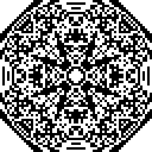
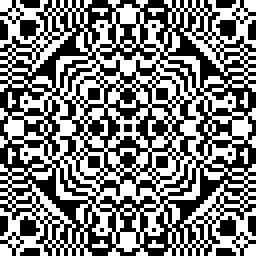
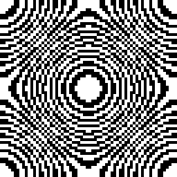
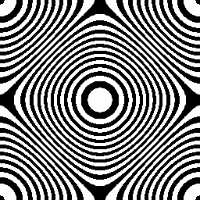
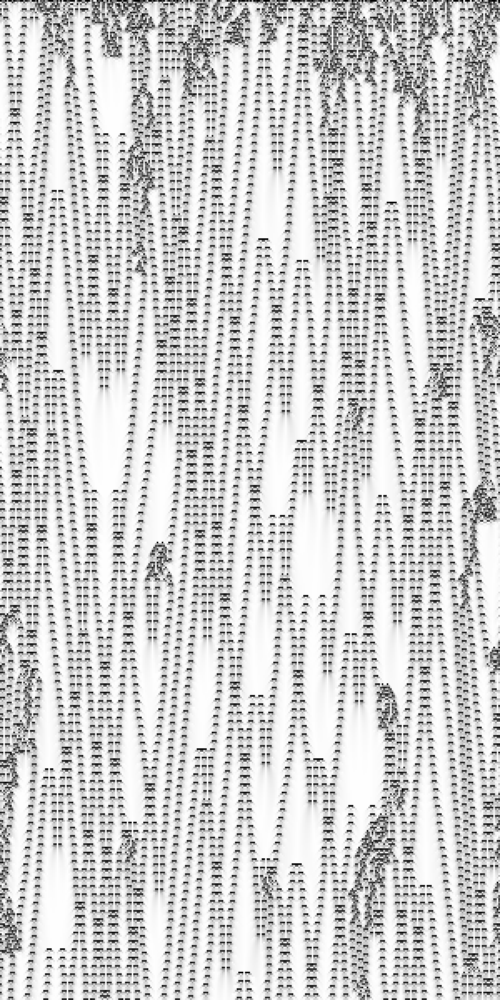
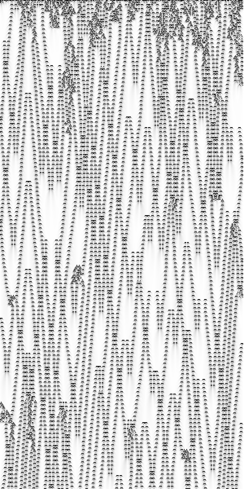
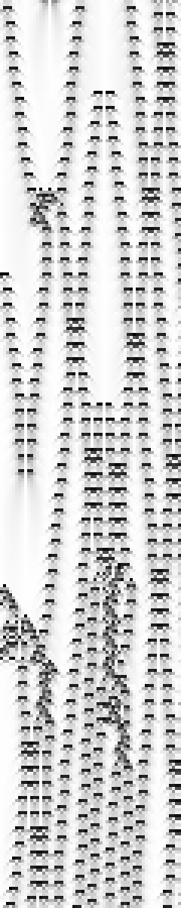
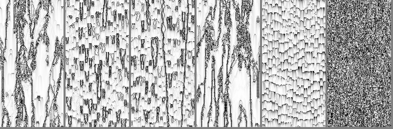
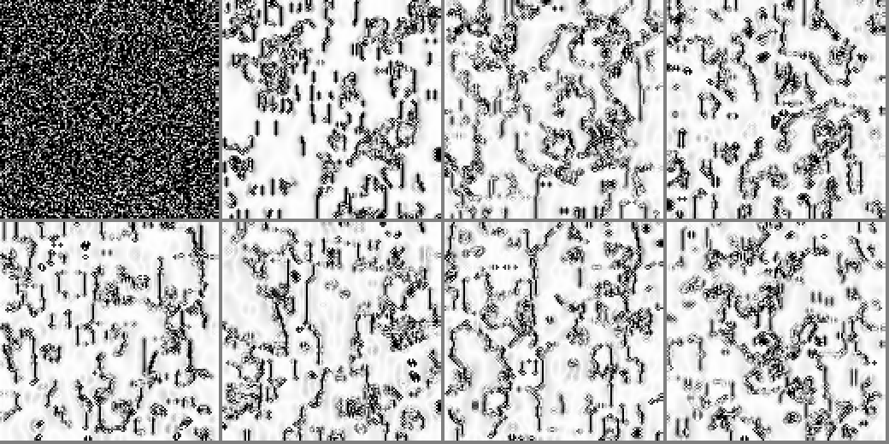
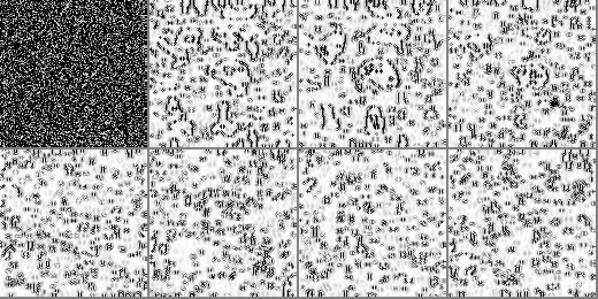

# Apparent complexity of quantized diffusion, and class-4 structures against the boundary strata of a box

Code, figures and LaTeX source for the article of the same title by
Miguel E. Pérez Ibarra and Jaziel Flores Rodríguez. The compiled article
is [`main.pdf`](main.pdf); the source is [`main.tex`](main.tex).

The article has two parts. Part I explains a set of black-and-white frames
produced by a heat-equation simulation. Part II moves the modulus from the
display into the dynamics, obtains Wolfram's continuous cellular automata on a
box with reflecting walls, and studies how their localized structures meet
the walls, edges and corners of the box.

## Part I: the frames are aliased contour maps

Colouring the cells of a finite-difference heat simulation by the parity of
`floor(10·u)` gives frames whose apparent complexity rises from nothing,
peaks in a lattice of symmetric concentric islands, and dies:

| step 150 | step 1000 | step 2000 |
|:--:|:--:|:--:|
|  |  |  |

They are the contour map of the temperature with isotherms every 0.1 degrees
and alternating fill. The rise is aliasing and the islands are the
replicated centres of an undersampled Fresnel zone plate. The same state on a
four times finer grid, with the same quantum, is an ordinary contour map:

| 64 × 64 cells, t = 0.4 | 256 × 256 cells, same state |
|:--:|:--:|
|  |  |

Three elementary results make this exact (Theorems 2.1, 3.1, 4.1 of the
article):

- the band count and the total variation are nonincreasing under Neumann
  heat flow on a box;
- the phase-averaged perimeter of the sampled pattern is exactly
  `sum over edges of dist(q·|jump across the edge|, 2Z)`, a triangle wave of the
  edge jump, and the discrete total variation is nonincreasing, so every
  increase of the perimeter comes from edges whose jump exceeds one quantum;
- the block entropy of the pattern has two non-commuting limits: `0` as the
  grid is refined, maximal as the quantum is refined.

Scripts: [`code/analyze.py`](code/analyze.py) (complexity measures against
time, resolution tests), [`code/phase_theorem.py`](code/phase_theorem.py)
(the random-phase identity checked against Monte-Carlo), results in
[`code/results_partI.txt`](code/results_partI.txt).

## Part II: the modulus inside the dynamics

The rule `u' = frac(mean of the (2n+1)-point neighbourhood + a)` is Wolfram's
continuous cellular automaton. On the box, the reflecting walls are
implemented with the ternary-cube rule (one three-case rule per axis), and the
first result is exact: **the box automaton equals the periodic automaton on
the doubled domain restricted to mirror-symmetric states**
([`code/reflection_principle.py`](code/reflection_principle.py) checks this
to the last digit). So a structure hitting a wall collides with its own
mirror image, an edge is a symmetric four-body collision, and a corner an
eight-body one.

### One dimension, a = 0.398 (class 4)

Periodic (left), mirror walls (middle), and the sixty cells nearest the left
wall magnified (right). Time runs downward; black where neighbours differ.

<p align="center">



</p>

Localized structures move at fixed speeds, cross, and return from the walls
as their mirror images. The wall node carries a third of the bulk activity
and the quiet layer is two cells deep.

### Two dimensions

The family has no sharp class-4 windows in two dimensions. Space-time cuts
for a = 0.33, 0.49, 0.51, 0.67, 0.02, 0.398:



Near a = 1/3 and 2/3 the dynamics is wandering phase walls between the three
phases of a period-three background; near 1/2, intermittent spots; on the
plateaus, chaos. The box with mirror walls, 128 × 128, at steps 0, 50, 100,
200 (top) and 400, 600, 800, 1200 (bottom):

a = 0.33, phase walls:



a = 0.49, intermittent spots:



### Activity per boundary stratum

Time-averaged fraction of active cells by codimension of the stratum in the
ternary cube (0 interior, 1 wall, 2 edge or 2-D corner, 3 corner):

| regime | grid | codim 0 | codim 1 | codim 2 | codim 3 |
|---|---|--:|--:|--:|--:|
| chaos, a = 0.398 | 128² | 0.989 | 0.948 | 0.739 | |
| chaos, a = 0.398 | 32³ | 0.997 | 0.993 | 0.981 | 0.927 |
| intermittent, a = 0.49 | 128² | 0.561 | 0.503 | 0.190 | |
| intermittent, a = 0.49 | 32³ | 0.475 | 0.494 | 0.500 | 0.334 |
| phase walls, a = 0.33 | 128² | 0.491 | 0.349 | 0.207 | |

The quiet layer is one cell deep in the chaotic and intermittent regimes and
about five cells deep in the phase-wall regime, where a wall approaching the
mirror annihilates with its own image.

## Running the code

Requirements: Python 3.12 with NumPy; pygame for the live viewer. No PIL is
needed, PNGs are written by [`code/pngio.py`](code/pngio.py), and
[`code/png2pdf.py`](code/png2pdf.py) converts them into vector PDFs (one
rectangle per run of equal cells) for the article, so the figures stay sharp
at any zoom.

```
cd code
python3.12 analyze.py                 # Part I tables and frames (writes ../out/)
python3.12 phase_theorem.py           # random-phase identity, discrete TVD
python3.12 view1d.py 0.398 300 600    # 1-D space-time diagrams
python3.12 strata.py 0.33 128 1500 32 800   # activity per stratum, 2-D and 3-D
python3.12 view2d.py 0.33 160 mirror  # live viewer: space = pause, r = reseed, q = quit
```

Other scripts: `scan1d.py`, `finescan1d.py`, `candidates1d.py`, `nks_repro.py`
(1-D scans and Wolfram's cases), `wall1d.py` (activity against distance to the
wall), `scan2d.py`, `cuts2d.py`, `filmstrip2d.py` (2-D), `restest.py`
(Part I resolution tests).

`ASSESSMENT.md` is the original analysis of the frames and `PROPOSAL.md` the
theorem proposal that became Part I.

## Building the article

```
pdflatex main.tex && pdflatex main.tex
```

## Related

The reflecting walls use the ternary-cube rule from the companion note
*One case, not twenty-seven: the ternary cube as the index set for boundary
stencils of finite-difference schemes in any dimension* by the same authors.

## License

Code under the MIT License (see `LICENSE`). The article text and figures are
© the authors.
